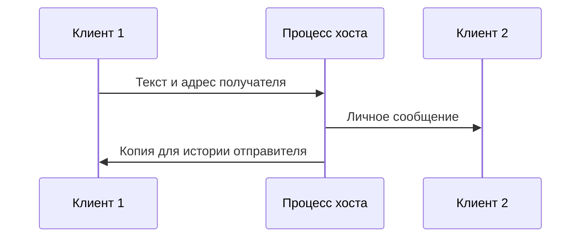

# Linux IPC Chat

Локальный многопользовательский чат на C++17 и Qt 6. На одном компьютере с Linux хост открывает своё окно и запускает каждого клиента отдельным процессом. Из любого окна можно написать всем участникам или выбрать одного собеседника.

Одну и ту же переписку можно запустить поверх трёх механизмов межпроцессного взаимодействия (IPC) — безымянных каналов, именованных каналов FIFO и локальных Unix-сокетов. Механизм выбирается командой запуска. Интерфейс и правила доставки у всех трёх общие.

## Быстрый старт на Ubuntu

Для сборки нужны компилятор с поддержкой C++17, GNU Make, Bash, CMake 3.16 или новее и Qt 6 Widgets. Для запуска окон нужна графическая сессия.

```bash
sudo apt update
sudo apt install git build-essential cmake qt6-base-dev
```

Склонируйте репозиторий по HTTPS, соберите проект и запустите чат с двумя клиентами:

```bash
git clone https://github.com/Aleksadv/linux-ipc-chat.git
cd linux-ipc-chat
make
./bin/host_pipe --clients 2
```

Откроются три окна — **Хост**, **Клиент 1** и **Клиент 2**. В окне клиента 1 оставьте в поле «Кому» значение «Общий чат», введите `Всем привет!` и нажмите **Enter**. Строка появится во всех трёх окнах. Теперь выберите «Клиент 2» и отправьте `Есть минутка?` — эту строку с пометкой «лично» увидят только два клиента.

Одно окно клиента можно закрыть независимо от остальных. Закрытие окна хоста завершает весь сеанс. История переписки хранится в памяти процессов до их завершения.

## Способы запуска

Все команды ниже выполняются из корня репозитория после `make`. Число после `--clients` задаёт количество клиентских процессов при старте. Допускается любое положительное значение в пределах доступных ресурсов. Без аргументов запускаются хост и один клиент.

| Команда | Соединение между хостом и одним клиентом |
|---|---|
| `./bin/host_pipe --clients 2` | Два безымянных канала `pipe()`, созданных до `fork()`. Один передаёт данные к хосту, другой — к клиенту. |
| `./bin/host_fifo --clients 2` | Два FIFO с именами `to-host` и `to-client`. Хост создаёт их после `fork()`, а каждый процесс открывает свои концы. |
| `./bin/host_sock --clients 2` | Двусторонняя пара Unix-сокетов, созданная вызовом `socketpair()` с `AF_UNIX` и `SOCK_SEQPACKET`. Родитель и потомок сохраняют по одному сокету. |

У FIFO соединение можно увидеть в файловой системе. Хост печатает в терминал строку `FIFO directory` с путём для каждого клиента. Пока чат открыт, в этом каталоге видны оба канала. Открытие концов согласуется межпроцессными семафорами с тайм-аутом пять секунд. При штатном завершении хост удаляет FIFO и их каталоги.

## Как доставляется сообщение

Хост совмещает две роли — участника переписки и посредника между процессами. Например, личное сообщение от клиента 1 клиенту 2 проходит такой путь:



Хост читает сообщение из соединения клиента 1 и проверяет отправителя и адрес. Затем направляет сообщение получателю и возвращает копию автору. Каждый из них видит текст ровно один раз. В собственном окне хост показывает личный текст только тогда, когда сам участвует в разговоре. Если выбранный клиент уже вышел, автор получает уведомление «Не отправлено».

**Процессы и потоки.** Хост создаёт потомков через `fork()` до запуска своих потоков Qt. Затем для каждого клиентского соединения стартует поток чтения `ClientReader`. Он следит за дескриптором через `QSocketNotifier` и передаёт полученное сообщение в главный поток хоста. Там хост выбирает получателей и обновляет окно.

**Порядок истории.** В момент отправки окно ставит метку общих для всех процессов часов `CLOCK_MONOTONIC`. Получатель вставляет строку в историю по этой метке, даже если сообщение пришло с задержкой. Видимый номер `#` назначает хост при обработке. Если два сообщения получили одинаковую метку времени, их порядок определяет этот номер.

**Бездействие.** У каждого клиента свой таймер. Когда клиент больше 60 секунд ничего не отправлял, хост завершает этот процесс через `SIGKILL` и показывает статус отключения. Входящая переписка таймер клиента не сбрасывает. Хост и остальные активные клиенты продолжают общаться.

### Формат сообщения

Каждую запись предваряют два байта длины тела, старший байт идёт первым. Благодаря длине получатель может восстановить запись, пришедшую частями, и разделить несколько записей, прочитанных за один раз. Тело сообщения содержит строку с четырьмя числами, перевод строки и пользовательский текст в UTF-8.

```text
1 2 0 123456789
Привет!
```

В этом примере клиент `1` пишет клиенту `2`. Номер `0` в третьем поле означает, что хост ещё не присвоил сообщению номер. Четвёртое поле — время отправки в наносекундах. Для адресата `-1` означает общий чат, а `0` — хоста. Предел для пользовательского текста — **4000 байт UTF-8**. На всё тело кадра вместе со служебными полями отводится до **4096 байт**.

## Структура проекта

```text
linux-ipc-chat/
├── Makefile                # Сборка командой make
├── build.sh                # Создание и очистка временного каталога сборки
├── CMakeLists.txt          # Цели host_pipe, host_fifo, host_sock и frame_check
├── src/
│   ├── host.cpp            # Аргументы запуска, fork() и завершение процессов
│   ├── chat/               # frame — границы записей, message — адреса, время и текст
│   ├── ipc/                # Интерфейс Connection и реализации трёх транспортов
│   ├── runtime/            # Клиентские сессии, потоки чтения, маршрутизация и таймеры
│   └── ui/                 # Окно Qt, выбор получателя и история переписки
└── tests/
    └── frame_check.cpp     # Автоматическая проверка кодирования и разбора кадров
```

`make` вызывает `build.sh`. Скрипт запускает CMake во временном каталоге, собирает проект с флагами `-Wall -Wextra -Werror` и помещает готовые программы в `bin/`. При выходе скрипт удаляет временный каталог. Каждая программа `host_*` собирается с общей логикой чата и одной реализацией транспорта из `src/ipc/conn_*.cpp`.

## Проверка

### Автоматический тест кадров

```bash
./bin/frame_check
```

При успехе программа выводит `frame_check: OK`. Тест проверяет неполный заголовок, получение текста по частям, два кадра подряд, передачу кириллицы, тело предельной длины и отклонение кадра с недопустимой длиной.

### Доставка в окнах

Запустите чат с `--clients 2`. Галочка означает одну копию сообщения в истории этого окна.

| Отправка | Хост | Клиент 1 | Клиент 2 |
|---|:---:|:---:|:---:|
| Клиент 1 → Общий чат | ✓ | ✓ | ✓ |
| Клиент 1 → Клиент 2 | — | ✓ | ✓ |
| Клиент 2 → Хост | ✓ | — | ✓ |
| Хост → Клиент 1 | ✓ | ✓ | — |

Чтобы проверить минутный таймер, откройте новый сеанс. Оставьте клиента 1 читающим, а с клиента 2 примерно на 40-й секунде напишите хосту. Чуть больше чем через минуту после старта окно клиента 1 закроется. Отправьте ещё одну строку из окна клиента 2 — хост по-прежнему её получит.

### Просмотр процессов и потоков на Linux

В Bash запустите хоста в фоне и сохраните его PID:

```bash
./bin/host_pipe --clients 2 &
chat_pid=$!
```

После появления окон выполните в том же терминале:

```bash
ps --ppid "$chat_pid" -o pid,ppid,comm
ps -T -p "$chat_pid" -o pid,tid,comm
```

Первая команда покажет два дочерних процесса с одним родителем. Вторая покажет потоки хоста, в том числе `chat-reader-1` и `chat-reader-2`.
